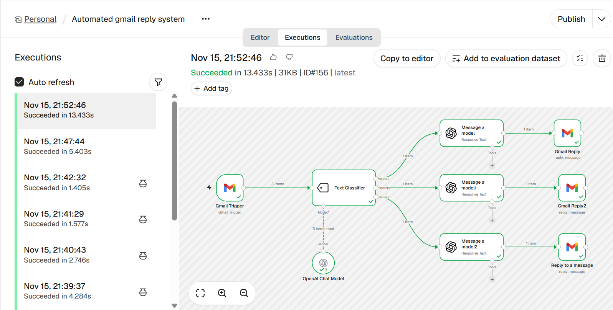

# Automated Gmail Reply System

An [n8n](https://n8n.io/) workflow that checks Gmail for new messages, classifies each message, generates a category-aware reply with OpenAI, and sends the reply to the original sender.

## Workflow

The diagram below shows the workflow structure. The Gmail Trigger passes incoming email to a classifier, which routes it through a matching AI reply-generation path and then to a Gmail reply node.

## How it works

1. **Gmail Trigger** polls for new email every minute.
2. **Text Classifier** classifies the email snippet into one of three categories:
   - **Orders** — new or existing order-related messages.
   - **Inquiry** — questions or requests for general information.
   - **Others** — messages that do not fit the first two categories.
3. **OpenAI** generates a response using the email subject and message context. The workflow uses GPT-4.1 for classification and GPT-4o for reply generation. Each category is routed to its own reply-generation node.
4. **Gmail Reply** sends the generated text as a reply to the original sender.

The n8n workflow definition is [`Automated gmail reply system.json`](Automated%20gmail%20reply%20system.json), and the diagram is available as [`Workflow.png`](Workflow.png).

## Requirements

- An n8n instance with the Gmail and LangChain/OpenAI nodes available.
- A Gmail account connected to n8n through Gmail OAuth2.
- An OpenAI API credential configured in n8n, with access to the models used in the workflow.

## Import and configure

1. In n8n, import `Automated gmail reply system.json` as a workflow.
2. Open the Gmail trigger and Gmail reply nodes, and select or create a Gmail OAuth2 credential for the account you want to use.
3. Open the OpenAI Chat Model and reply-generation nodes, and select or create an OpenAI API credential.
4. Review the classification descriptions and reply-generation instructions. Adjust them for your use case and preferred tone.
5. Test the workflow with representative messages and verify the generated replies before enabling it.
6. Activate the workflow when you are ready for it to poll Gmail and send replies automatically.

> **Important:** The workflow is configured to send generated replies automatically. Test it carefully, and consider adding a human approval step before the Gmail Reply nodes if messages need review. The exported workflow references credential names/IDs; it does not contain your actual Gmail or OpenAI secrets. Configure credentials securely in n8n, and do not commit API keys or OAuth tokens to this repository.

## Workflow status

The exported workflow is currently **inactive** (`active: false`). Importing it does not by itself enable automatic replies; activate it in n8n after configuring and testing the credentials and behavior.

## Customization

- Change the Gmail trigger polling schedule or add filters to control which messages are processed.
- Edit the classifier categories and descriptions to match your email use case.
- Adjust the model prompts, models, and reply style in the OpenAI nodes.
- Add approval, logging, or error-handling steps before sending replies.

## License

No license is specified in this repository. Add a `LICENSE` file if you want to grant others permission to use, modify, or distribute this project.
